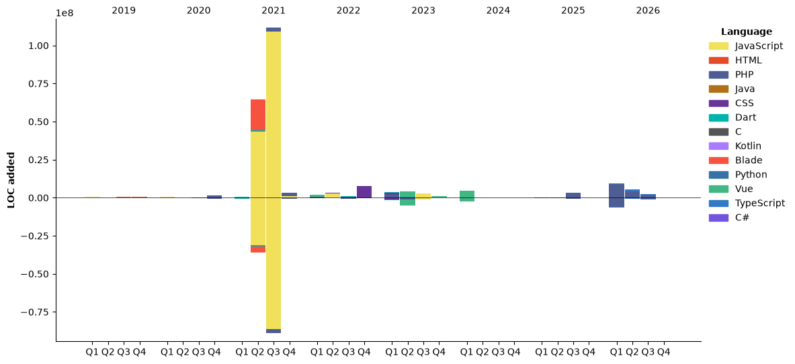

# Hi, I'm Junior Lawrence Kibirige 👋

**Senior Full-Stack Engineer** · Kampala, Uganda 🇺🇬 · Remote

I build and maintain production systems end to end, from data model and migrations through APIs and background jobs to web and mobile UI. I've been doing this professionally for 10+ years, mostly on fintech, identity, e-commerce and impact platforms used across Africa and Europe.

I enjoy the hard parts: tracking down race conditions, fixing slow queries on tables with millions of rows, making integrations fail safely, and writing tests that catch the bugs before users do.

### 🛠️ Tech I work with
**Backend:** Laravel · PHP 8 · Node.js · Python · REST APIs · Queues · Redis · WebSockets
**Frontend:** TypeScript · React · Vue 3 · Next.js · Tailwind CSS
**Mobile:** Flutter / Dart (iOS & Android)
**Data:** MySQL (query tuning, indexing, read replicas) · pandas · Metabase
**Cloud & delivery:** AWS (Lambda, S3, SQS/SNS) · Docker · Azure DevOps · GitHub · DigitalOcean · Sentry
**Testing:** PHPUnit · Vitest · React Testing Library · Playwright
**AI-assisted development:** Claude Code daily. I write agent-ready specs, then review, test and correct everything AI produces.

### 🚀 Things I've built
- **VerifyKYC:** identity-verification API for Uganda that integrates with the national identity systems. I fixed concurrent-write races, made failed external calls an explicit (non-billable) state, and moved heavy reporting to a MySQL read replica.
- **Foodiverse (FoodCloud):** food-donation logistics for donors, charities and foodbanks in Ireland and the UK. I shipped 176 merged PRs across Laravel, Vue and Flutter, including an automation engine, cross-tenant security fixes, and a fix for a slow query on a 21M-row table.
- **CreditBridge Zambia:** credit reference bureau platform. React + TypeScript lender portal (credit search, scorecards, risk gauge, analytics) on a Laravel API, with identity resolution and data quality tooling.
- **GreenChain:** e-waste collection platform. Laravel API, WhatsApp chatbot and Flutter app for field collectors (OTP login, offline support, biometric unlock).
- **Asanty + EFRIS:** e-commerce platform, plus an integration with Uganda Revenue Authority's e-invoicing system using certificate-based request signing.

### 📦 Open source
- [**dpo_standard**](https://github.com/juniorkibirige/dpo_standard): Flutter package for integrating DPO payments into apps with a server-side backend.

> Most of my professional work lives in private client repositories. I'm happy to walk through any of it.

### 📫 Get in touch
[LinkedIn](https://linkedin.com/in/junlawren) · junkib94@gmail.com

<!--START_SECTION:waka-->


**🐱 My GitHub Data** 

> 📦 1.1 MB Used in GitHub's Storage 
 > 
> 🏆 1,580 Contributions in the Year 2026
 > 
> 💼 Opted to Hire
 > 
> 📜 77 Public Repositories 
 > 
> 🔑 22 Private Repositories 
 > 
**I Mostly Code in PHP** 

```text
PHP                      48 repos            ████████░░░░░░░░░░░░░░░░░   32.43 % 
Dart                     25 repos            ████░░░░░░░░░░░░░░░░░░░░░   16.89 % 
TypeScript               11 repos            ██░░░░░░░░░░░░░░░░░░░░░░░   07.43 % 
Blade                    2 repos             ░░░░░░░░░░░░░░░░░░░░░░░░░   01.35 % 
C#                       1 repo              ░░░░░░░░░░░░░░░░░░░░░░░░░   00.68 % 
```


**Timeline**




 Last Updated on 01/11/2026 05:32:18 UTC
<!--END_SECTION:waka-->
